# Blockchain Data Management

**DataLedger** is a data-management platform that uses a blockchain as a shared, tamper-evident control plane for
enterprise datasets. The data itself never goes on-chain: files stay off-chain, encrypted per object. What the chain
holds is everything you need to *trust* the data: fingerprints of every version, record-level Merkle roots, lineage
between datasets, purpose-bound access grants, a log of every read, and independent data-quality attestations.

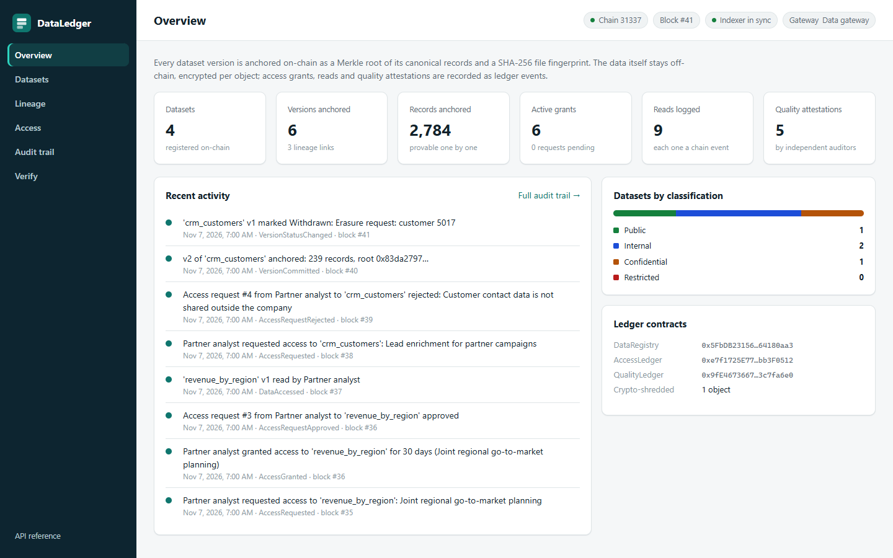

| | |
|---|---|
| **Smart contracts** | Solidity 0.8.28, OpenZeppelin 5.4, Foundry: 3 contracts, 70 tests (unit, fuzz, invariant, cross-language golden vector), 100% line and branch coverage |
| **Data service** | Python 3.12, FastAPI, web3.py 7, SQLAlchemy 2: ingestion, envelope encryption, wallet-signed API, access gateway, public verification |
| **Indexer** | Event-sourced read models in SQL, rebuilt from chain logs, re-org aware |
| **Console** | Dependency-free web console: catalogue, versions, lineage graph, access, audit trail, verification |
| **Cryptography** | Keccak-256 Merkle trees (OpenZeppelin compatible), SHA-256 file fingerprints, AES-256-GCM with per-object keys, EIP-191 request signatures |
| **Quality gates** | 147 automated tests across both languages, end-to-end runs against a real local chain |
| **Docker** | Images on Docker Hub: [`sadrulemail/dataledger`](https://hub.docker.com/r/sadrulemail/dataledger) and [`sadrulemail/dataledger-contracts`](https://hub.docker.com/r/sadrulemail/dataledger-contracts); one `docker compose up` runs the chain, the deployment, the API and the console |

---

## Contents

1. [Why a blockchain for data management](#why-a-blockchain-for-data-management)
2. [Core concepts](#core-concepts)
3. [Architecture](#architecture)
4. [Key flows](#key-flows)
5. [Smart contracts](#smart-contracts)
6. [Data service and API](#data-service-and-api)
7. [Reference scenario](#reference-scenario)
8. [Screens](#screens)
9. [Run with Docker](#run-with-docker)
10. [Run it locally](#run-it-locally)
11. [Quality gates](#quality-gates)
12. [Design decisions and trade-offs](#design-decisions-and-trade-offs)
13. [Taking it to production](#taking-it-to-production)
14. [Project structure](#project-structure)

---

## Why a blockchain for data management

When data moves between teams, business units or companies, the hard questions are not about storage. They are
about trust:

- *Is the file I received exactly what the producer published, or was it edited along the way?*
- *Which upstream data was this report built from, and is any of it now known to be bad?*
- *Who has read this dataset, under which approval, and for what purpose?*
- *Did anyone independent check the quality before we used it?*

A conventional database can store the answers, but whoever administers that database can also rewrite them. A
blockchain changes the trust model: the records are append-only, replicated, time-stamped by consensus, and the
rules that govern them (who may publish, who may grant access, what a valid lineage link is) are enforced by code
that every party can read. No single administrator, including the platform operator, can quietly change history.

The design principle is a strict split between what the ledger is good at and what it is not:

| On-chain (public, permanent, small) | Off-chain (private, erasable, large) |
|---|---|
| Dataset registry, owners, stewards, classification | The data files themselves, encrypted at rest |
| Per version: Merkle root, SHA-256 fingerprint, record count, schema hash, storage pointer | Schema documents and quality reports (content-addressed, hash anchored on-chain) |
| Lineage links between versions | Data keys, wrapped by a key-encryption key |
| Access requests, purpose hashes, grants with expiry, revocations | Address-book labels shown in the console |
| One event per read, with a receipt hash | SQL read models rebuilt from chain events |
| Quality attestations: auditor, score, verdict, report hash | |

Personal data never touches the chain. That keeps the ledger small and cheap, and it is what makes the right to
erasure possible (see [crypto-shredding](#8-privacy-and-the-right-to-erasure)).

---

## Core concepts

### 1. Anchoring: commit to the data without publishing it

When a version is published, the service computes two commitments and the owner anchors them on-chain in one
transaction:

- **File fingerprint**: `SHA-256(file bytes)`. Anyone holding the exact file can prove it is the published one.
- **Merkle root over records**: every row is turned into a *canonical record*, hashed into a leaf, and the leaves
  are folded into a binary Merkle tree. The 32-byte root commits to every record and its position.

<picture>
  <source media="(prefers-color-scheme: dark)" srcset="docs/diagrams/merkle-tree-dark.png">
  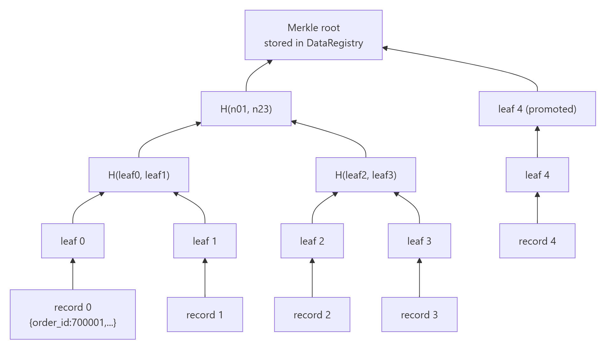
</picture>

**Canonical records.** Two files can hold the same data and still differ byte for byte (`12.50` vs `12.5`,
column order, CRLF vs LF, a leading zero in an id). Before hashing, every row is normalised against the dataset
schema: integers and decimals are parsed and written in one form, dates and timestamps are written in ISO-8601,
booleans become `true`/`false`, keys are sorted and JSON is written without whitespace. Cells that do not parse
keep their raw text, so any file can be anchored and the quality checks report the bad cells.

**Leaf design.** `leaf = keccak256(keccak256(abi.encode(index, recordBytes)))`.
Encoding the position binds each record to its row, so a valid record cannot be replayed at another index.
Hashing twice means a leaf can never be confused with an internal 64-byte node (second-preimage protection).
Pairs are hashed in sorted order, which is the convention used by OpenZeppelin's `MerkleProof`, so the contract
verifies proofs with audited library code. The Python and Solidity implementations share a golden test vector.

### 2. Record-level proofs

A consumer can prove that *one row* belongs to a published version without revealing any other row. The proof
is the list of sibling hashes from the leaf to the root: for the 1,500-row orders extract that is 11 hashes. The
contract checks it in a `view` call (`DataRegistry.verifyRecord`), so verification is free and needs no
account. An auditor, regulator or counterparty can check a single invoice line against the anchored version.

### 3. Verification levels

Uploading a file to the public verify endpoint (no account needed) returns one of four answers:

| Result | Meaning |
|---|---|
| `exact_match` | The SHA-256 of the file is anchored; the response says which dataset version it is. |
| `records_match` | The bytes differ (formatting) but every canonical record matches the version's Merkle root. |
| `mismatch` | The records do not reproduce the anchored root: the data was changed. |
| `unknown` | The fingerprint is not anchored and no version was named to compare against. |

Callers with access can also ask for a **row-level diff** that names the exact rows that changed, were added or
were removed, by comparing leaves with the anchored tree.

### 4. Versions and lifecycle

Versions are immutable. A correction is a new version, never an edit. Each version carries its own schema hash
(schema evolution is visible on-chain through `SchemaChanged`) and moves through a one-way lifecycle:

<picture>
  <source media="(prefers-color-scheme: dark)" srcset="docs/diagrams/version-lifecycle-dark.png">
  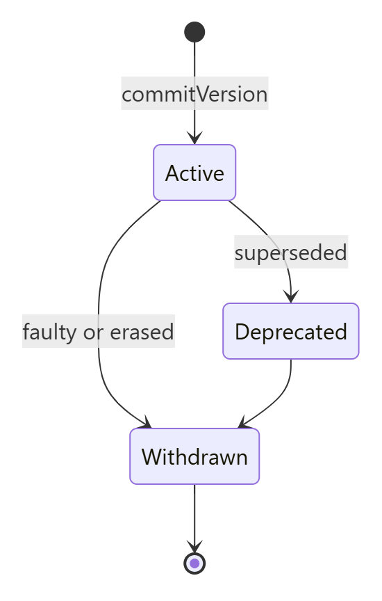
</picture>

*Deprecated* versions are still served and still valid as lineage parents. *Withdrawn* versions are never served
again by the gateway and can no longer be used as parents or attested. Datasets can be archived (closed for new
versions while old ones stay verifiable), reclassified, and handed to a new owner through a two-step transfer.

### 5. Lineage

When a version is committed it names the exact upstream versions it was built from (up to 16). The contract
rejects parents that do not exist, are withdrawn, or are listed twice, so the lineage graph on-chain is always
closed and well-formed (an invariant checked by fuzzing). Because parents are *versions* rather than datasets,
lineage answers precise questions: if a customer extract is withdrawn after an erasure request, the console shows
exactly which downstream versions were derived from it.

### 6. Consent and access control

Every dataset has a classification: `Public`, `Internal`, `Confidential` or `Restricted`. Public data is
readable by anyone who signs a request. For everything else:

1. A consumer calls `requestAccess` with a stated purpose. The purpose text is emitted in the event and its
   keccak hash is stored, so the approval is bound to that purpose.
2. The owner or a steward approves with a duration (at most 365 days) or rejects with a reason.
3. Grants can be revoked by the owner or renounced by the grantee at any time.

The data gateway enforces this at read time. For every download it checks `hasAccess` **live on-chain** (not
from a cache), verifies the stored file against the anchored fingerprint and Merkle root, and then calls
`AccessLedger.logAccess`, which rechecks access inside the contract and emits `DataAccessed` with a receipt hash.
Only after that transaction succeeds does data leave the gateway. A bug or a compromised gateway cannot read data
silently: every read either leaves evidence on-chain or does not happen.

### 7. Independent data-quality attestations

An auditor (`AUDITOR_ROLE`) reads a version through the gateway like any consumer, runs the checks locally
(required values, type conformance, primary-key uniqueness, duplicate records), publishes the report as a
content-addressed document and signs `QualityLedger.attest` with the score and the report hash. Two rules keep
attestations meaningful: an auditor cannot attest a dataset it owns or stewards (`ConflictOfInterest`), and each
auditor attests a version once. Reports list row positions only, never cell values, so a report can be shared
next to a confidential dataset.

### 8. Privacy and the right to erasure

Blockchains are immutable and privacy laws grant a right to erasure. The platform reconciles the two with
**envelope encryption and crypto-shredding**:

- Each stored object is sealed with its own random 256-bit data key (AES-256-GCM). The ciphertext is bound to the
  file fingerprint as associated data, so a sealed object cannot be swapped for another.
- The data key is wrapped by a key-encryption key from a key ring (named keys, newest first). Rotation re-wraps
  data keys without touching the objects (`dataledger rotate-keys`).
- Erasure: the owner withdraws the version on-chain and the gateway destroys the wrapped data key and the
  ciphertext. What remains on-chain is a set of hashes that can no longer be linked to any recoverable content.
  The withdrawal reason and the off-chain shred event stay in the audit trail.

Objects are content-addressed by the SHA-256 of their sealed bytes, so storage corruption is detected on every
read, before decryption.

### 9. Event sourcing

The SQL database behind the API is a *projection* of chain events, not a source of truth. The indexer reads logs
in block ranges, applies them in `(block, logIndex)` order and commits each batch together with its cursor, so a
crash never leaves half a block applied. It stores the hash of the last processed block; if that block is
replaced (a chain re-organisation), the read models are dropped and rebuilt from the deployment block. A
configurable confirmation depth trades freshness for stability on public networks.

### 10. Trust model

| Threat | What stops it |
|---|---|
| A file is edited after publication | Fingerprint and Merkle root on-chain; `verify/file` and record proofs detect any change |
| Stored ciphertext is corrupted or swapped | Content addressing (SHA-256 of sealed bytes) and AES-GCM authentication bound to the fingerprint |
| The gateway serves data without permission | `logAccess` rechecks access in the contract and reverts; every served read has a chain event |
| An administrator rewrites the audit trail | Events are on-chain; the SQL trail can be rebuilt from logs and compared |
| A record is moved to another row | Leaves encode the row position |
| A leaf is forged from internal nodes | Double-hashed leaves |
| A data owner rubber-stamps their own quality | `ConflictOfInterest` in `QualityLedger` |
| A signed API request is replayed | Signature covers method, path, time and a one-time nonce; nonces are remembered for the validity window |
| Personal data must be erased | Nothing personal is on-chain; crypto-shredding destroys the only key |

---

## Architecture

<picture>
  <source media="(prefers-color-scheme: dark)" srcset="docs/diagrams/architecture-dark.png">
  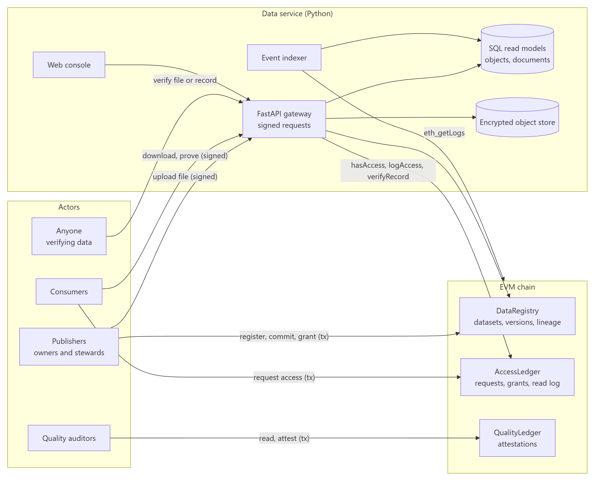
</picture>

Writes that change governance state (registering, committing, granting, attesting) are signed by the actor's own
wallet and go straight to the chain. The service never holds those keys. It holds one key of its own, the
gateway key, whose only power is to log reads.

---

## Key flows

### Publishing a version

<picture>
  <source media="(prefers-color-scheme: dark)" srcset="docs/diagrams/publish-flow-dark.png">
  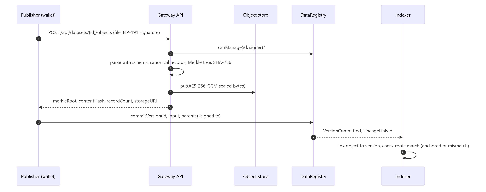
</picture>

### Reading data under a grant

<picture>
  <source media="(prefers-color-scheme: dark)" srcset="docs/diagrams/read-flow-dark.png">
  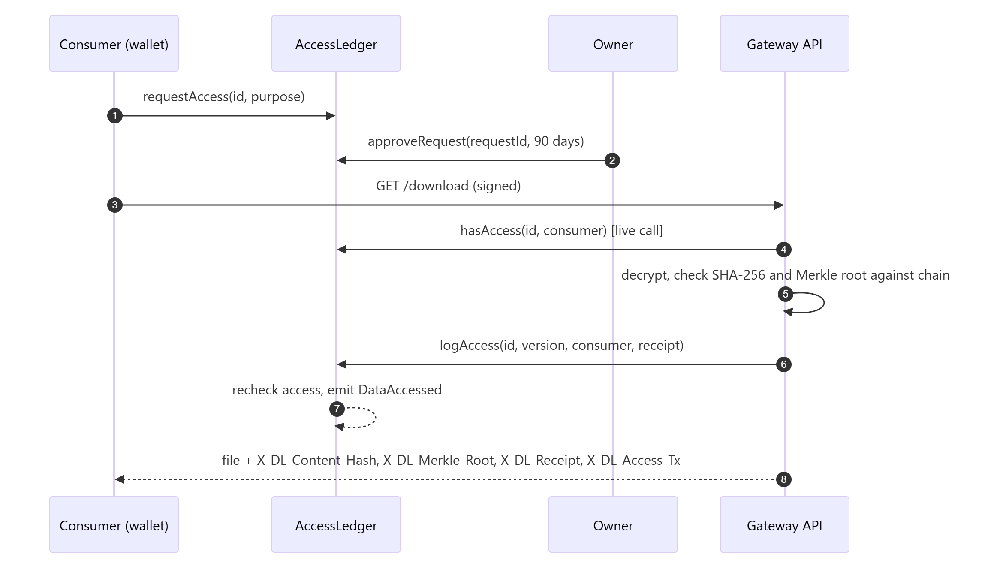
</picture>

### Verifying a single record

<picture>
  <source media="(prefers-color-scheme: dark)" srcset="docs/diagrams/record-proof-dark.png">
  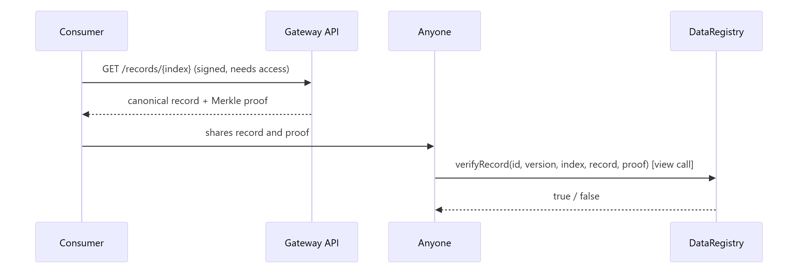
</picture>

---

## Smart contracts

All three contracts use OpenZeppelin `AccessControl`, custom errors and events for every state change.
`DataRegistry` is also `Pausable` for emergencies.

### DataRegistry

| Function | Who | Purpose |
|---|---|---|
| `registerDataset(name, classification, schemaHash, metadataURI)` | `PUBLISHER_ROLE` | Creates a dataset owned by the caller |
| `commitVersion(id, {merkleRoot, contentHash, schemaHash, recordCount, storageURI}, parents[])` | owner, steward | Anchors an immutable version with lineage |
| `setVersionStatus(id, version, status, reason)` | owner, steward | Active → Deprecated → Withdrawn |
| `setSteward`, `setClassification`, `archiveDataset` | owner | Governance of a dataset |
| `updateMetadata` | owner, steward | Points at a new metadata document |
| `transferDatasetOwnership` / `acceptDatasetOwnership` | owner / new owner | Two-step hand-over |
| `verifyRecord(id, version, index, record, proof)` | anyone (view) | Record inclusion proof |
| `locateContent(contentHash)` | anyone (view) | Which version first anchored this file |
| `pause` / `unpause` | `PAUSER_ROLE` | Emergency stop for writes |

Events: `DatasetRegistered`, `VersionCommitted`, `LineageLinked`, `SchemaChanged`, `VersionStatusChanged`,
`StewardUpdated`, `MetadataUpdated`, `ClassificationChanged`, `DatasetArchived`, `OwnershipTransferStarted`,
`OwnershipTransferred`.

### AccessLedger

| Function | Who | Purpose |
|---|---|---|
| `requestAccess(id, purpose)` | anyone | Opens one pending request per dataset and requester |
| `approveRequest(requestId, duration)` / `rejectRequest(requestId, reason)` | owner, steward | Decide a request |
| `cancelRequest(requestId)` | requester | Withdraw a pending request |
| `grantAccess(id, grantee, duration, purpose)` / `revokeAccess(id, grantee)` | owner, steward | Direct grants |
| `renounceAccess(id)` | grantee | Give up a grant early |
| `logAccess(id, version, accessor, receiptHash)` | `GATEWAY_ROLE` | Rechecks access, refuses withdrawn versions, emits `DataAccessed` |
| `hasAccess(id, account)` | anyone (view) | Public, owner, steward, or a live unrevoked grant |

### QualityLedger

| Function | Who | Purpose |
|---|---|---|
| `attest(id, version, scoreBps, passed, reportHash, reportURI)` | `AUDITOR_ROLE`, not a manager of the dataset | One attestation per auditor and version |
| `qualitySummary(id, version)` | anyone (view) | Count, passes and lowest score |

### Gas profile

Measured with `forge test --gas-report` (median, cancun EVM). Verification calls are `view` and cost nothing when
called off-chain.

| Operation | Gas |
|---|---|
| `registerDataset` | ~129k |
| `commitVersion` (no parents / with lineage links) | ~220k / up to ~340k |
| `grantAccess` | ~103k |
| `logAccess` (one read) | ~31k–68k |
| `attest` | ~155k (first attestation) |
| `verifyRecord` | ~9k–10k, free as a view call |

A version costs the same whether the file has ten rows or ten million: only the root goes on-chain.

---

## Data service and API

The Python package `dataledger` (in `service/`) contains:

| Module | Responsibility |
|---|---|
| `canonical.py` | Schemas, typed normalisation, canonical JSON records, record leaves |
| `merkle.py` | Merkle tree, proofs and leaf-level diffs, compatible with OpenZeppelin `MerkleProof` |
| `crypto.py` | Key ring, AES-256-GCM envelope encryption, key rotation |
| `storage.py` | Content-addressed object store (local filesystem; same interface fits S3, Azure Blob or IPFS) |
| `chain.py` | Typed contract client, transaction sending, custom-error decoding |
| `indexer.py` | Event indexer with cursor, batch commits and re-org recovery |
| `platform.py` | Gateway operations: ingest, gated reads, proofs, diffs, verification, crypto-shredding |
| `quality.py` | Data-quality checks and reports without cell values |
| `auth.py` | EIP-191 signed requests with freshness window and nonce replay protection |
| `api.py` | FastAPI app (OpenAPI docs at `/docs`) and the web console |
| `cli.py` | `dataledger` command line for every role |

### Endpoints

| Method and path | Auth | Description |
|---|---|---|
| `GET /api/health` | public | Chain id, head and indexed block, gateway address, contract addresses |
| `GET /api/overview` | public | Platform statistics and recent activity |
| `GET /api/datasets`, `GET /api/datasets/{id}` | public | Catalogue and dataset detail (versions, lineage, grants, requests, reads, quality, schema) |
| `GET /api/lineage?dataset_id=&version=` | public | Lineage graph, optionally focused on a dataset |
| `GET /api/audit?dataset_id=` | public | Unified audit trail (chain events and gateway actions) |
| `GET /api/access-requests` | public | All access requests |
| `GET /api/documents/{hash}`, `POST /api/documents` | public / signed | Content-addressed schema and report documents |
| `POST /api/datasets/{id}/objects` | signed, owner or steward | Stage an encrypted upload, returns values to anchor |
| `GET /api/datasets/{id}/versions/{v}/download` | signed, access | Verified, logged download |
| `GET /api/datasets/{id}/versions/{v}/records/{i}` | signed, access | Canonical record and Merkle proof |
| `POST /api/datasets/{id}/versions/{v}/diff` | signed, access | Row-level differences against the anchored version |
| `POST /api/datasets/{id}/versions/{v}/shred` | signed, owner | Destroy the data key and ciphertext |
| `POST /api/verify/file` | public | Exact match, records match, mismatch or unknown |
| `POST /api/verify/record` | public | On-chain record proof check |

**Signed requests.** The caller signs this text with `personal_sign` and sends the address, issue time, nonce and
signature in `X-DL-*` headers:

```text
DataLedger signed request
Method: GET
Path: /api/datasets/2/versions/2/download
Address: 0x15d34AAf54267DB7D7c367839AAf71A00a2C6A65
Issued: 2026-11-07T07:00:00Z
Nonce: 5f0c9a1e7b2d4c6f8a9b0c1d
```

The signature proves who is asking. Whether they may read is always decided by the contracts.

---

## Reference scenario

`scripts/load_reference_data.py` drives the running platform through a full governance cycle with seven roles
(each a separate wallet): platform admin, data gateway, quality auditor, sales operations, finance analytics, a
data engineer and an external partner analyst. The reference datasets in `datasets/` are generated
deterministically by `scripts/generate_datasets.py`.

1. **Registration.** Sales operations registers `crm_customers` (Confidential, contains contact e-mails),
   `sales_orders` (Internal) and `product_catalog` (Public), and makes the data engineer a steward of
   `sales_orders`.
2. **A flawed extract.** The September orders extract (721 rows) is published. It has three missing customer ids
   and one double-booked order.
3. **The fix.** The corrected October extract (1,500 rows) is published as v2 and v1 is deprecated.
4. **Access with purpose.** Finance analytics requests access to orders and customers for the monthly close;
   sales approves 90-day grants. Finance reads all three inputs through the gateway, and every read is a chain
   event.
5. **A derived dataset with lineage.** Finance builds `revenue_by_region` (net revenue by month, region and
   category) and commits it with three parents: orders v2, customers v1, catalog v1.
6. **Independent quality audit.** The auditor gets review grants, reads each version and attests:
   orders v1 **fails at 84.8%**, every other version passes at 100%.
7. **Partner sharing.** The partner analyst is granted the aggregate for go-to-market planning and reads it;
   a request for customer contacts is rejected with a reason on-chain.
8. **Right to erasure.** Customer 5017 asks to be forgotten: customers v2 is published without them, v1 is
   withdrawn with the reason on-chain and then crypto-shredded. The lineage graph still shows that revenue v1 was
   built from the withdrawn version.

End state: 4 datasets, 6 versions, 2,784 records anchored, 3 lineage links, 6 active grants, 9 reads logged
on-chain, 5 quality attestations, 1 object crypto-shredded.

---

## Screens

| Dataset versions | Lineage |
|---|---|
| 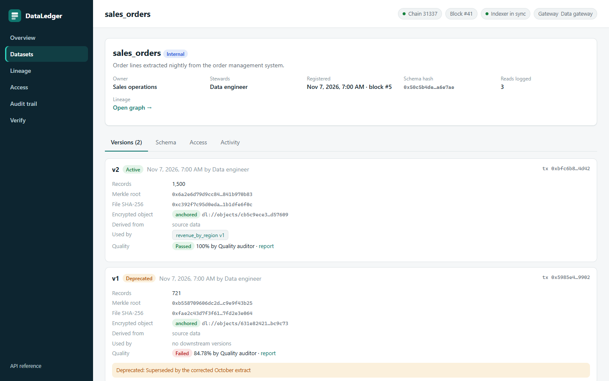 | 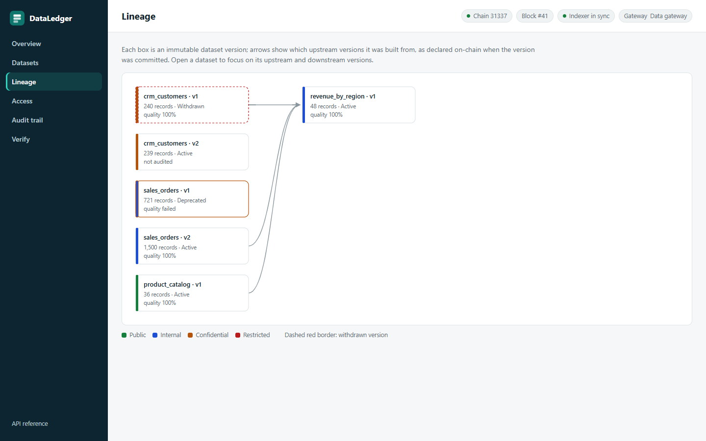 |
| **Access grants and requests** | **Audit trail** |
| 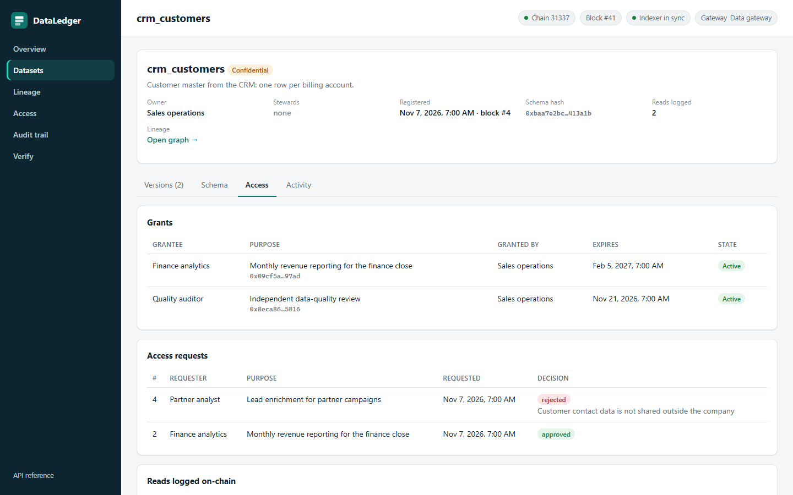 | 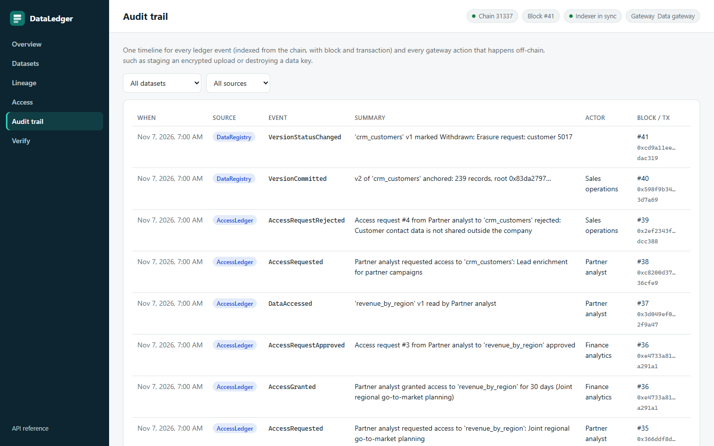 |
| **Catalogue** | **Access requests** |
| 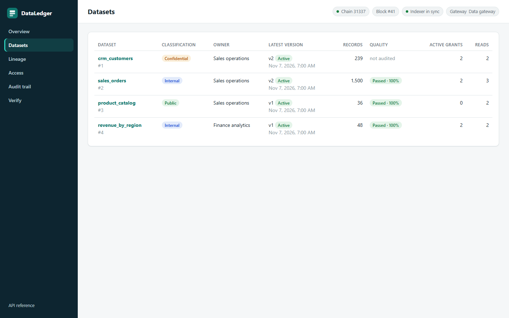 | 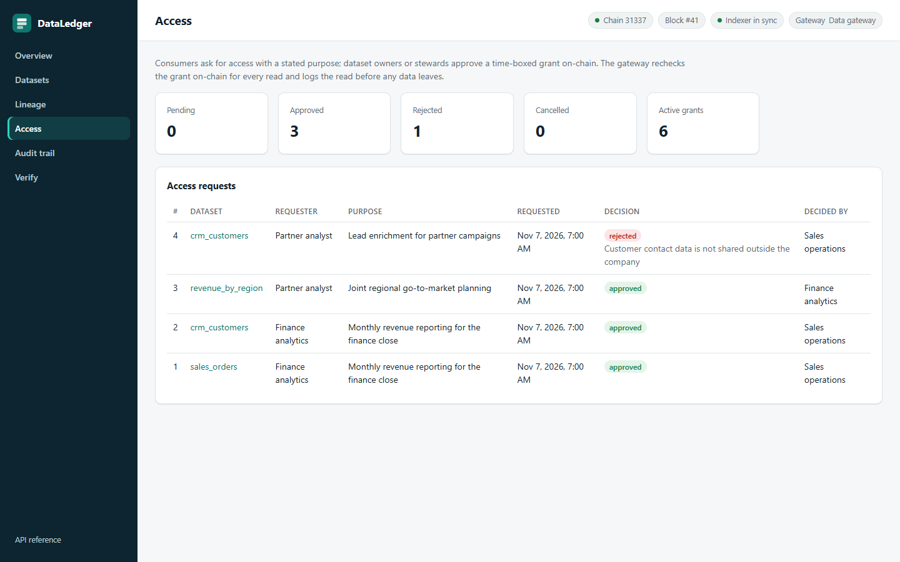 |

**Verification.** Left: a received copy of the orders file in which one unit price was quietly changed; the
recomputed Merkle root does not match the anchored one. Right: a record proof produced with `dataledger prove`
checked against the contract.

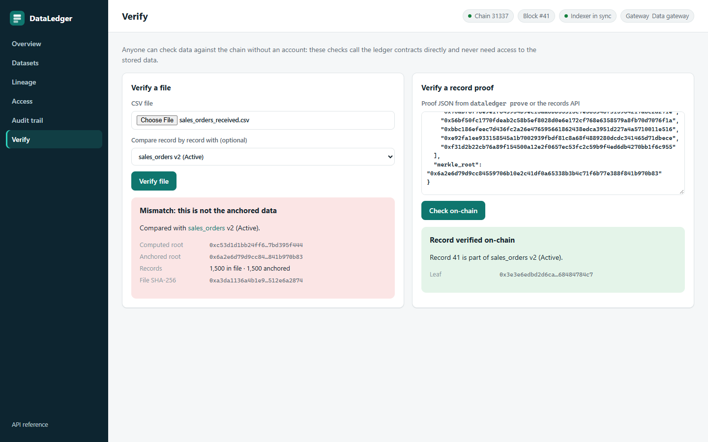

---

## Run with Docker

The platform is published as two images on Docker Hub (linux/amd64, tags `1.0.0` and `latest`):

| Image | Contents |
|---|---|
| [`sadrulemail/dataledger`](https://hub.docker.com/r/sadrulemail/dataledger) | Data service: API gateway, event indexer, web console and CLI, plus the reference datasets |
| [`sadrulemail/dataledger-contracts`](https://hub.docker.com/r/sadrulemail/dataledger-contracts) | The three ledgers compiled with Foundry: runs a local chain (`chain`) or deploys to any RPC endpoint (`deploy`) |

[`docker-compose.yml`](docker-compose.yml) is all you need. It starts a local chain, deploys the ledgers, then
starts the service once the deployment has finished:

```bash
docker compose up -d
```

Play the reference scenario (optional), then open the console at <http://localhost:8000>:

```bash
docker compose --profile reference-data run --rm reference-data
```

The CLI runs inside the service container:

```bash
docker compose exec api dataledger verify-file --file /app/datasets/sales_orders_2026-10.csv
```

Stop the stack and delete every volume:

```bash
docker compose down -v
```

- **State survives restarts.** The chain keeps its state in the `chain` volume and the deploy step is skipped
  when the ledgers already exist, so `docker compose down` followed by `up` brings back the same chain, data and
  read models.
- **Keys.** Without `DATALEDGER_MASTER_KEYS`, the service generates a key ring and keeps it in its data volume.
  That is convenient on a laptop, but anyone holding the volume then holds both the ciphertext and the key.
  Anywhere else, inject the keys from a secret store, either as `DATALEDGER_MASTER_KEYS` or as a mounted file
  named in `DATALEDGER_MASTER_KEYS_FILE`.
- **Other chains.** Run the contracts image with `deploy`, set `RPC_URL` and `DEPLOYER_PRIVATE_KEY`, and mount
  `/app/deployments` to collect `<chainId>.json`. Point the service's `DATALEDGER_DEPLOYMENT_FILE` at that file.
- **Building from source.** `docker compose build`, or the `docker build --target` commands at the top of the
  [`Dockerfile`](Dockerfile).

---

## Run it locally

### Prerequisites

- [Foundry](https://book.getfoundry.sh/getting-started/installation) (`forge`, `anvil`)
- Python 3.12 and [uv](https://docs.astral.sh/uv/)

### 1. Contracts

```bash
git clone --recurse-submodules https://github.com/sadrulemail/blockchain-data-management.git
```

```bash
cd blockchain-data-management/contracts && forge build && forge test
```

### 2. Local chain and deployment

Start a local chain in its own terminal:

```bash
anvil
```

Deploy the three ledgers and grant the operating roles (the keys and addresses are anvil's public development
accounts):

```bash
GATEWAY_ADDRESS=0x70997970C51812dc3A010C7d01b50e0d17dc79C8 \
AUDITOR_ADDRESS=0x3C44CdDdB6a900fa2b585dd299e03d12FA4293BC \
PUBLISHER_ADDRESSES=0x90F79bf6EB2c4f870365E785982E1f101E93b906,0x15d34AAf54267DB7D7c367839AAf71A00a2C6A65 \
forge script script/Deploy.s.sol --rpc-url anvil --broadcast \
  --private-key 0xac0974bec39a17e36ba4a6b4d238ff944bacb478cbed5efcae784d7bf4f2ff80
```

This writes `contracts/deployments/31337.json`, which the service reads.

### 3. Service

```bash
cd ../service && uv sync && cp .env.example .env
```

Generate a key-encryption key and put the printed line into `.env`:

```bash
uv run dataledger keygen --kid kek-1
```

Start the API, indexer and console in its own terminal:

```bash
uv run dataledger serve
```

### 4. Load the reference scenario

```bash
uv run python ../scripts/load_reference_data.py
```

Open the console at <http://127.0.0.1:8000> and the OpenAPI reference at <http://127.0.0.1:8000/docs>.

### 5. Use the CLI

Each command signs with the key in `DATALEDGER_PRIVATE_KEY` (or `--key-env NAME`).

```bash
export DATALEDGER_PRIVATE_KEY=0x47e179ec197488593b187f80a00eb0da91f1b9d0b13f8733639f19c30a34926a
```

```bash
uv run dataledger prove 2 2 41 > proof.json && uv run dataledger verify-record proof.json
```

```bash
uv run dataledger verify-file --file ../datasets/sales_orders_2026-10.csv
```

| Command | Role | What it does |
|---|---|---|
| `register --schema s.json --classification confidential` | publisher | Publishes the schema document and registers the dataset |
| `publish --dataset 2 --file f.csv [--parent 1:1]` | owner, steward | Uploads, then anchors the version with lineage |
| `status 2 1 --to deprecated --reason "..."` | owner, steward | Lifecycle change |
| `steward 2 0xabc...` / `grant 2 0xabc... "purpose" --days 30` / `revoke` | owner | Stewardship and grants |
| `request-access 2 "purpose"` / `approve 1 --days 90` / `reject 1 "reason"` | consumer / owner | Request flow |
| `download 2 2 --out f.csv` / `prove 2 2 41` | consumer | Logged download, record proof |
| `verify-file --file f.csv [--dataset 2 --version 2]` / `verify-record proof.json` | anyone | Public verification |
| `quality 2 2` | auditor | Reads, checks, publishes the report and attests on-chain |
| `shred 1 1 --reason "erasure request"` | owner | Withdraws on-chain and destroys the data key |
| `serve`, `index [--once]`, `keygen`, `rotate-keys` | operator | Run and maintain the service |

---

## Quality gates

| Suite | Count | What it covers |
|---|---|---|
| Contract unit tests | 62 | Every function, role check, custom error and event, status transitions, ownership hand-over, pause, deploy script |
| Contract fuzz tests | 4 × 1,000 runs | Proofs accepted for every record, rejected when tampered or moved; grant expiry boundaries |
| Contract invariants | 3 × 128 runs × 64 calls | Counters match commits, lineage graph always closed, withdrawn is final |
| Golden vector | 1 | Same records give the same Merkle root in Solidity and in the Python unit suite |
| Python unit tests | 58 | Canonicalisation, Merkle trees, encryption and tamper detection, storage, quality checks, request signing |
| End-to-end tests | 19 | Real anvil chain per run: publish, gated reads, on-chain proof checks, file verification, diffs, storage tampering, lineage, attestations, conflict of interest, withdrawal and crypto-shredding, key rotation, indexer rebuild and re-org recovery |

Contract coverage is 100% of lines, statements, branches and functions (`forge coverage`). Python line coverage
is 83%.

```bash
cd contracts && forge test && forge coverage --report summary --no-match-coverage "(test|script)"
```

```bash
cd service && uv run ruff check . && uv run pytest
```

---

## Design decisions and trade-offs

**Hashes on-chain, data off-chain.** Storing data on a chain is expensive, public to every node, and impossible
to delete. Anchoring a 32-byte root gives the same tamper evidence at a fixed cost per version.

**Merkle root per version rather than a transaction per record.** One transaction anchors any number of rows,
while still allowing proofs for single rows. The trade-off is that a proof needs the full version to build, which
the gateway has.

**A gateway that enforces on-chain rules, rather than keys handed out on-chain.** Encrypting data to each
grantee's key would remove the gateway from the read path but makes revocation meaningless (a grantee keeps
what they decrypted) and makes erasure impossible. A gateway that checks grants live and logs every read keeps
revocation and erasure real, and `logAccess` rechecks access inside the contract so the gateway cannot bypass
the rules without leaving evidence.

**Logging every read on-chain.** It costs one small transaction per read (~31k gas). For high-volume reads the
same design can batch receipts into a Merkle root per interval and anchor that instead.

**Purpose hashes.** Purposes are bound to grants by hash. Request purposes are emitted in full so reviewers can
read them, and direct-grant purposes travel in the transaction calldata; nothing personal belongs in a purpose.

**Event-sourced SQL.** The chain is the source of truth, the database is a fast, disposable view. SQLite is the
default; the SQL layer is SQLAlchemy Core with dialect-aware upserts for PostgreSQL.

**Any EVM chain.** The contracts use no chain-specific features. The same code runs on a consortium network
(Hyperledger Besu, Quorum), a public L2, or a public testnet, depending on who must be able to verify.

---

## Taking it to production

- Key-encryption keys and the gateway signer in a KMS or HSM instead of environment variables.
- Object store on S3, Azure Blob or GCS (the `ObjectStore` interface has four methods), PostgreSQL for read models.
- Confirmations set to the finality of the target chain; indexer as its own process (`dataledger index`).
- Multisig or a timelock as `DEFAULT_ADMIN_ROLE`, separate `PAUSER_ROLE`.
- Batched read receipts for high-volume datasets.
- Per-version salts for datasets with low-entropy rows, so record hashes cannot be guessed.
- Static analysis (Slither) and an external audit before mainnet.

---

## Project structure

```text
blockchain-data-management/
├── Dockerfile                    service and contracts images (one target each)
├── docker-compose.yml            chain, deployment, service and reference scenario
├── docker/                       image entry points
├── contracts/                    Foundry project
│   ├── src/
│   │   ├── DataRegistry.sol      datasets, versions, lineage, record proofs
│   │   ├── AccessLedger.sol      requests, grants, read log
│   │   ├── QualityLedger.sol     independent attestations
│   │   └── interfaces/IDataRegistry.sol
│   ├── script/Deploy.s.sol       deploy, grant roles, write deployments/<chainId>.json
│   └── test/                     unit, fuzz, invariant and deploy tests
├── service/                      Python data service (uv project)
│   ├── src/dataledger/           API, indexer, crypto, Merkle, CLI, web console, bundled ABIs
│   └── tests/                    unit tests and end-to-end tests against anvil
├── datasets/                     reference CSVs, schema documents, address book
├── scripts/
│   ├── generate_datasets.py      deterministic reference data
│   ├── load_reference_data.py    full governance cycle against a running platform
│   ├── export_abi.py             copy ABIs from the Foundry build into the service
│   ├── capture_screenshots.py    console screenshots for this README
│   └── render_diagrams.py        README diagrams from docs/diagrams/*.mmd
└── docs/
    ├── diagrams/                 Mermaid sources and rendered light/dark PNGs
    └── screenshots/
```

## License

MIT, see [LICENSE](LICENSE).
